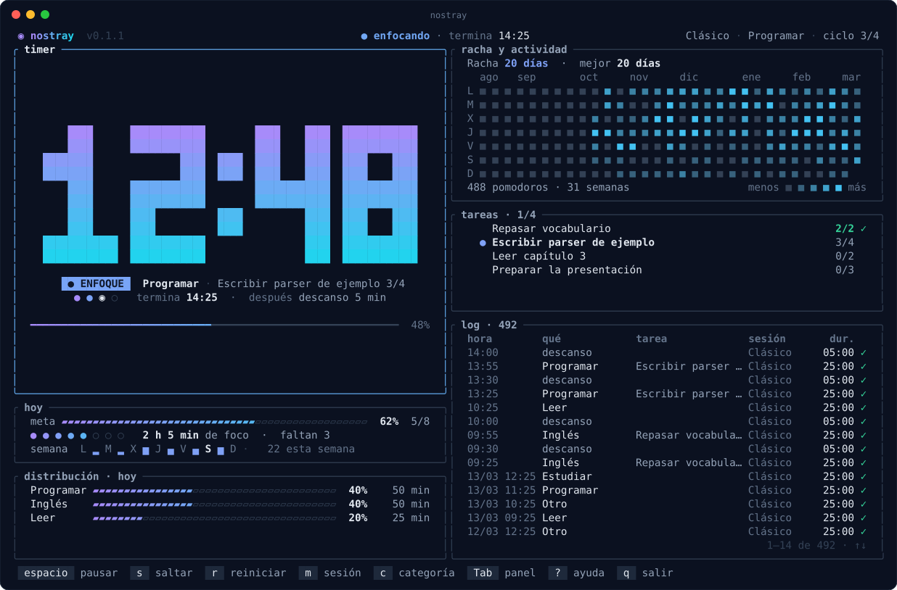
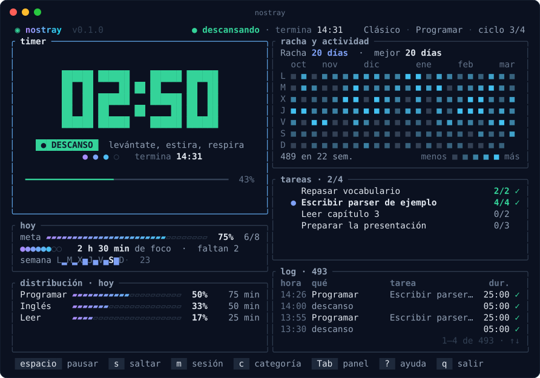
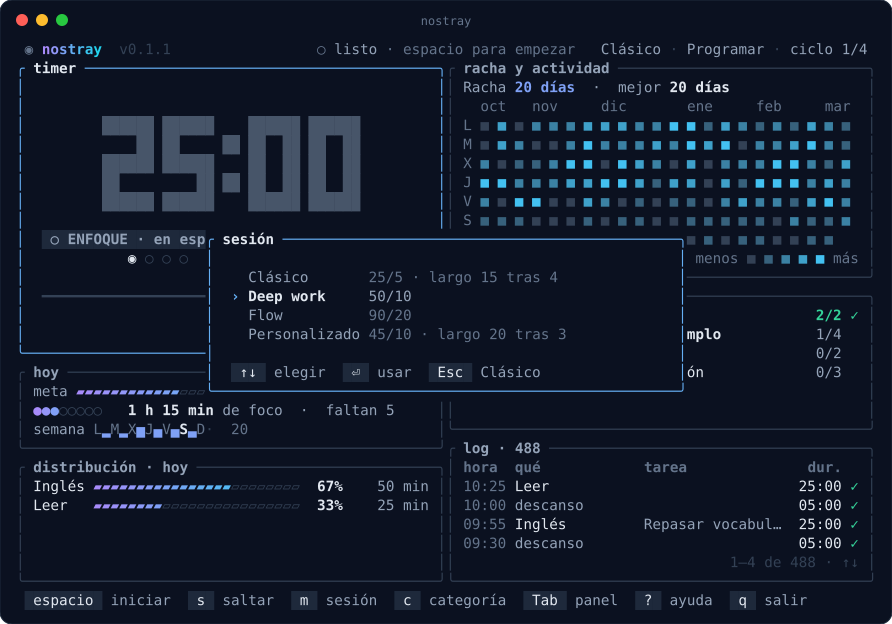
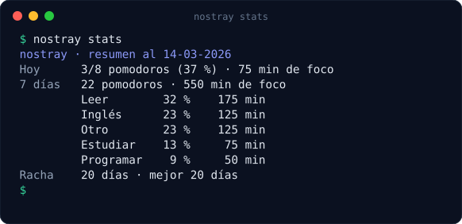

<div align="center">

# nostray

**Pomodoro en la terminal. Para no desviarte.**

Una app de terminal para mantener el enfoque en lo que estés haciendo: programar, estudiar,
practicar inglés, leer… Sesiones tipo, categorías, meta diaria, racha y un heatmap de
actividad al estilo GitHub. Sin cuentas, sin red, sin servicios.

[](https://crates.io/crates/nostray-tui)
[](https://github.com/AngheloBR/nostray-tui/actions/workflows/ci.yml)
[](#licencia)

Español · [English](README.md)



</div>

## Lo destacado

- **TUI interactiva.** Reloj grande, hora de fin, serie de ciclos `● ● ◉ ○` y lo que viene
  después. La cabecera muestra el estado en vivo. Ejecutas `nostray` y listo.
- **Sesiones tipo.** Clásico 25/5 con descanso largo, Deep work 50/10, Flow 90/20 y una
  Personalizada que se edita en la propia TUI.
- **Categorías y tareas.** Cada foco cuenta para una categoría (Programar, Estudiar, Inglés,
  Leer, Otro, o las tuyas) y, si quieres, para una tarea con pomodoros estimados.
- **Meta diaria, racha y heatmap.** Un punto por pomodoro hasta tu meta, la semana en
  minibarras, la racha de días seguidos y hasta 53 semanas de actividad.
- **CLI para el día a día.** `nostray start --session deep --tag Inglés` abre directo;
  `nostray stats` imprime el resumen sin abrir la TUI.
- **Avisos de escritorio** con `notify-send` al terminar cada fase, sin pasar por una shell.
  Si no está instalado, la app sigue igual.
- **Tus datos, en local y a salvo.** JSON y TOML en las rutas XDG, escrituras atómicas y nada
  se borra: un archivo dañado se aparta como `.bak`.
- **Un único binario.** Sin base de datos ni red; los precompilados son estáticos (musl) y no
  dependen de ninguna librería del sistema.

## Instalación

### Binario precompilado (recomendado)

Descargas un archivo y ya. No necesitas Rust ni paquetes extra:

```sh
curl -fsSL https://github.com/AngheloBR/nostray-tui/releases/latest/download/nostray-x86_64-unknown-linux-musl.tar.gz \
  | tar xz --strip-components=1 -C ~/.local/bin nostray-x86_64-unknown-linux-musl/nostray
```

En ARM (Raspberry Pi, laptops ARM) usa `aarch64-unknown-linux-musl`.
Cada versión trae también su checksum `.sha256`.

### Fedora / RHEL / openSUSE (.rpm) · Debian / Ubuntu / Mint (.deb)

Descarga el paquete para tu sistema desde la
[última versión](https://github.com/AngheloBR/nostray-tui/releases/latest) e instálalo con tu
gestor de paquetes:

```sh
sudo dnf install ./nostray-tui-*.x86_64.rpm     # Fedora, RHEL
sudo apt install ./nostray-tui_*_amd64.deb      # Debian, Ubuntu, Mint
```

El binario de dentro es estático, así que el mismo paquete funciona en versiones viejas y
nuevas. Los paquetes recomiendan `libnotify` (`libnotify-bin` en Debian) para los avisos de
escritorio. Para desinstalar: `sudo dnf remove nostray-tui` / `sudo apt remove nostray-tui`.

### Con Cargo (crates.io)

Si ya tienes Rust (1.88+):

```sh
cargo install nostray-tui     # instala el comando `nostray`
```

Para actualizar, repite el mismo comando; para desinstalar, `cargo uninstall nostray-tui`.
Cargo deja el binario en `~/.cargo/bin`; si la terminal no encuentra `nostray`, agrega esa
carpeta a tu `PATH`.

### Desde el código

Para tener los últimos cambios de `main` aún sin publicar:

```sh
cargo install --git https://github.com/AngheloBR/nostray-tui
```

### Requisitos

- Linux y una terminal con color (truecolor para ver el degradado).
- Opcional: `notify-send` (paquete `libnotify`) para los avisos de escritorio.

## La TUI

```sh
nostray
```

Al abrir eliges la sesión; con `espacio` arranca el foco.



| Panel | Qué muestra |
|-------|-------------|
| **timer** | Dígitos grandes, fase (enfoque, descanso, pausa o en espera), categoría y tarea activa. Debajo, la serie hasta el descanso largo (`●` hecho, `◉` actual, `○` pendiente), la hora a la que termina y lo que viene después. El borde se ilumina mientras corre. |
| **hoy** | Barra y porcentaje de la meta diaria (por defecto 8; puede pasar de 100 %), un punto por pomodoro, minutos de foco, cuántos faltan y la semana de lunes a domingo en minibarras. |
| **distribución** | Minutos y porcentaje por categoría, de hoy o de los últimos 7 días (`v`). Los porcentajes suman 100. |
| **racha y actividad** | Racha actual y mejor racha (días seguidos con al menos un pomodoro; la actual sigue viva hasta que acaba el día) y un heatmap de hasta 53 semanas. Con meta 8, cada día tiene nivel 1 con 1–2 pomodoros, 2 con 3–4, 3 con 5–6 y 4 con 7 o más. |
| **tareas** | Opcional. Pomodoros hechos y estimados, tarea activa (`●`); cada foco completado suma uno a la tarea activa. |
| **log** | Una fila por fase cerrada (hora, categoría o descanso, tarea, sesión, duración, `✓` completada o `↷` saltada), la más reciente arriba. |

Solo cuentan para las estadísticas los focos completados; los saltados y los descansos
aparecen en el log pero no suman.



### Sesiones

| Sesión        | Enfoque | Descanso | Descanso largo            |
|---------------|---------|----------|---------------------------|
| Clásico       | 25 min  | 5 min    | 15 min tras 4 focos       |
| Deep work     | 50 min  | 10 min   | —                         |
| Flow          | 90 min  | 20 min   | —                         |
| Personalizado | 1–180   | 1–60     | 1–90 min tras 1–12 focos  |

La sesión Personalizado se edita en la TUI (`m` → Personalizado → `e`) o en `config.toml`.
Al terminar una fase, la siguiente queda en espera hasta que pulses `espacio`. Cambiar de
sesión con un ciclo en curso pide confirmación y lo reinicia; si la cancelas, no se guarda
nada.



### Categorías

Cada foco se asigna a la categoría vigente al cerrarse; se cambia con `c`. La lista se edita
en `config.toml`: de 1 a 8 nombres únicos de 1 a 20 caracteres. El historial guarda el nombre
tal cual, así que una categoría que quites de la configuración sigue contando en las
estadísticas.

### Atajos

| Tecla               | Acción                                              |
|---------------------|-----------------------------------------------------|
| `espacio`           | iniciar · pausar · reanudar                         |
| `s`                 | saltar la fase actual                               |
| `r`                 | reiniciar la fase actual                            |
| `m`                 | cambiar de sesión                                   |
| `c`                 | cambiar de categoría (flechas o `1`–`8`)            |
| `Tab` / `Shift+Tab` | panel siguiente / anterior (rota los ocultos)       |
| `?`                 | ayuda con todos los atajos (`↑↓` si no cabe)        |
| `q`                 | salir (pide confirmación si hay un ciclo en curso)  |
| `Ctrl+C`            | salir ya                                            |

Con el panel enfocado:

| Panel        | Teclas |
|--------------|--------|
| tareas       | `a` alta · `e` editar · `x` borrar · `⏎` activa (o la desmarca) · `+`/`-` estimado (1–20) · `↑↓` mover |
| log          | `↑↓` · RePág/AvPág · Inicio/Fin |
| distribución | `v` hoy / 7 días |

### Tamaños de terminal

| Ancho   | Disposición |
|---------|-------------|
| < 100   | Una columna: timer y hoy fijos; el resto apilado si cabe, o en un hueco que rota con `Tab` |
| 100–139 | Dos columnas: timer, hoy, distribución · actividad, tareas, log |
| ≥ 140   | Dos columnas; dígitos a escala grande si hay altura |

Por debajo de 40×12 se muestra un aviso de tamaño mínimo. La cabecera y el pie se adaptan:
lo menos importante se recorta primero.

## La CLI

```sh
nostray                                   # TUI con el selector de sesión
nostray start                             # TUI directa con la sesión Clásico
nostray start --session deep --tag Inglés # sesión y categoría elegidas
nostray stats                             # resumen en texto y sale
nostray --help | --version
```

- `--session`: `clasico`, `deep`, `flow` o `personalizado` (por defecto `clasico`).
- `--tag`: una de las categorías de `config.toml`, sin distinguir mayúsculas. Si no existe,
  `nostray` lo indica, lista las válidas y sale con código 2.
- La TUI necesita una terminal interactiva; `stats` no.



## Cómo funciona

- **Temporizador puro.** Una máquina de estados (en espera → corriendo ⇄ en pausa) que recibe
  la hora en cada operación y nunca duerme. Mide con el reloj monotónico, así que cambiar la
  hora del sistema no altera una fase en curso.
- **Fecha local al cerrar.** Cada fase se guarda con su instante UTC y el día local en que
  terminó, así que las estadísticas no cambian si viajas de zona horaria.
- **Escrituras atómicas.** Archivo temporal, `sync`, renombrado y `sync` del directorio.
  Si un archivo no se puede leer (JSON/TOML corrupto o de una versión desconocida), no se
  borra: se renombra a `.bak` (`.bak.1`, `.bak.2`…), se arranca con uno vacío y se avisa.
- **Terminal siempre restaurada.** Al salir de forma normal, con `Ctrl+C`, con
  SIGTERM/SIGHUP/SIGINT y también si el programa entra en pánico.
- **Avisos sin shell.** `notify-send --app-name=nostray -- <título> <cuerpo>` con argumentos
  separados; el proceso se recoge en un hilo para no bloquear la interfaz.

### Datos

| Archivo                                | Contenido          |
|----------------------------------------|--------------------|
| `$XDG_DATA_HOME/nostray/history.json`  | historial de fases |
| `$XDG_DATA_HOME/nostray/tasks.json`    | tareas             |
| `$XDG_CONFIG_HOME/nostray/config.toml` | configuración      |

Si no están definidas las variables XDG, se usan `~/.local/share/nostray/` y
`~/.config/nostray/`. Si `config.toml` no existe, se crea con valores por defecto y
comentarios. Un valor fuera de rango se sustituye por el de por defecto solo en memoria (con
aviso); el archivo no se toca.

`config.toml` por defecto:

```toml
# nostray: configuración

# Pomodoros por día (1–24).
daily_goal = 8

# Categorías de enfoque (1–8, únicas, 1–20 caracteres).
categories = ["Programar", "Estudiar", "Inglés", "Leer", "Otro"]

# Sesión Personalizado, en minutos.
[custom]
focus_min = 45        # 1–180
break_min = 10        # 1–60
long_break_min = 20   # 1–90
cycles = 3           # 1–12: descanso largo tras N focos
```

Para probar sin tocar tus datos:

```sh
XDG_DATA_HOME=/tmp/nostray-prueba/data XDG_CONFIG_HOME=/tmp/nostray-prueba/config nostray
```

### Renombrar el programa

El nombre sale de una sola constante, `APP_NAME` en `src/main.rs`; de ella derivan las rutas
de datos, el título y los textos. Para renombrar, cambia `APP_NAME` y el `name` de `[[bin]]`
en `Cargo.toml` al mismo valor (el test `app_name_coincide_con_binario` falla si no
coinciden). Los datos guardados con el nombre anterior no se migran.

## Limitaciones

- El reloj monotónico no avanza mientras el equipo está suspendido: una fase en curso durante
  una suspensión termina más tarde.
- Sin bloqueo entre instancias: si abres dos a la vez, la última que guarda gana.
- Al salir con un ciclo a medias, el tiempo de esa fase no se guarda.
- Cuando la TUI guarda la configuración (al editar la sesión Personalizado), `config.toml` se
  reescribe sin los comentarios.
- `nostray stats` usa la misma carga que la TUI: si falta `config.toml` lo crea y si un
  archivo está corrupto lo renombra a `.bak`.
- Desarrollado y probado en Linux (Fedora, X11). Fuera de alcance por ahora: sonido,
  integración con git, sincronización, red, temas configurables, plugins y exportación.

## Desarrollo

```sh
cargo test
cargo clippy --all-targets -- -D warnings
cargo fmt --check
cargo test snapshots -- --ignored   # regenera las capturas de docs/
cargo test demo -- --ignored        # regenera docs/demo.svg
```

Los tests usan un reloj falso (sin esperas reales) y directorios temporales dentro de
`target/`. Las capturas salen del mismo código que dibuja la TUI, con datos ficticios, así que
siempre coinciden con la app.

## Licencia

Doble licencia [MIT](LICENSE-MIT) o [Apache-2.0](LICENSE-APACHE), a tu elección.
