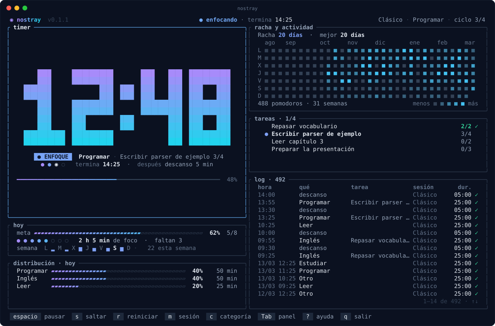
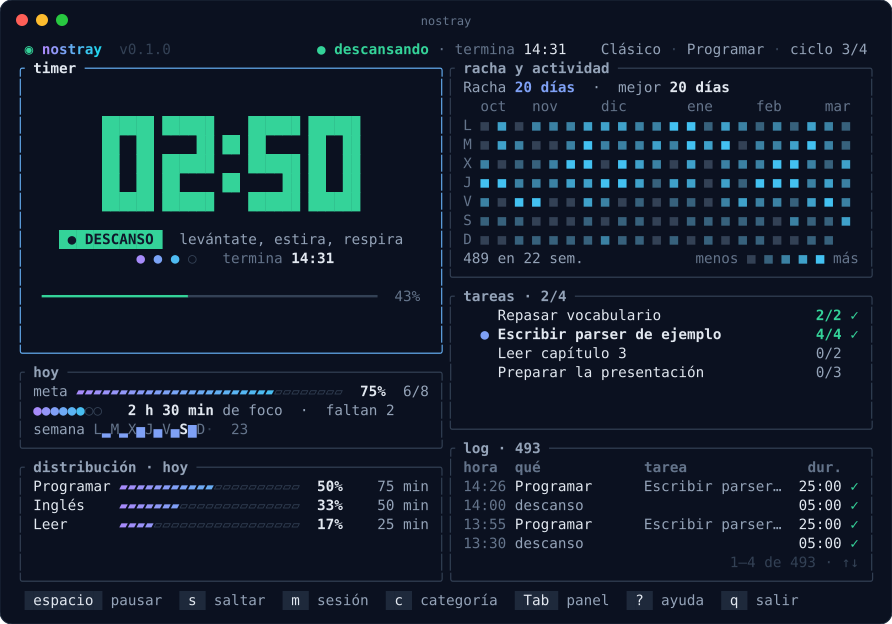
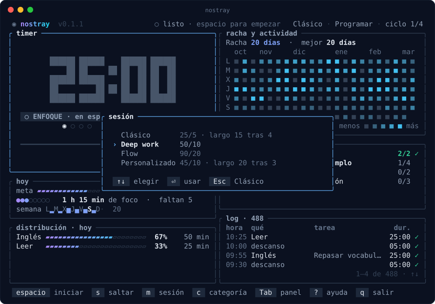
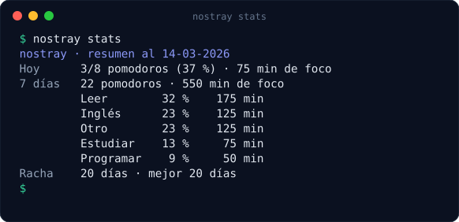

<div align="center">

# nostray

**Pomodoro in your terminal. Stay on track.**

A terminal app to keep you focused on whatever you're doing: coding, studying, practising a
language, reading… Preset sessions, categories, a daily goal, streaks and a GitHub-style
activity heatmap. No accounts, no network, no services.

[](https://crates.io/crates/nostray-tui)
[](https://github.com/AngheloBR/nostray-tui/actions/workflows/ci.yml)
[](#license)

[Español](README.es.md) · English



</div>

The interface is in Spanish. The full documentation, with more detail, is in
[README.es.md](README.es.md).

## Highlights

- **Interactive TUI.** Big clock, end time, a cycle series `● ● ◉ ○` and what comes next.
  The header shows the live state. Run `nostray` and you're in.
- **Preset sessions.** Classic 25/5 with a long break, Deep work 50/10, Flow 90/20 and a
  Custom one you edit right in the TUI.
- **Categories and tasks.** Every focus counts towards a category (Programar, Estudiar,
  Inglés, Leer, Otro, or your own) and, optionally, a task with estimated pomodoros.
- **Daily goal, streak and heatmap.** One dot per pomodoro up to your goal, the week as mini
  bars, your streak of consecutive days and up to 53 weeks of activity.
- **CLI for everyday use.** `nostray start --session deep --tag Inglés` opens straight in;
  `nostray stats` prints a summary without opening the TUI.
- **Desktop notifications** through `notify-send` when a phase ends, never through a shell.
  Without it, the app works just the same.
- **Your data stays local and safe.** JSON and TOML under the XDG paths, atomic writes, and
  nothing is ever deleted: a damaged file is moved aside as `.bak`.
- **A single binary.** No database, no network; prebuilt binaries are static (musl) and
  depend on no system library.

## Install

### Prebuilt binary (recommended)

Download one file and you're done. No Rust or extra packages needed:

```sh
curl -fsSL https://github.com/AngheloBR/nostray-tui/releases/latest/download/nostray-x86_64-unknown-linux-musl.tar.gz \
  | tar xz --strip-components=1 -C ~/.local/bin nostray-x86_64-unknown-linux-musl/nostray
```

On ARM (Raspberry Pi, ARM laptops) use `aarch64-unknown-linux-musl`.
Every release also ships a `.sha256` checksum.

### Fedora / RHEL / openSUSE (.rpm) · Debian / Ubuntu / Mint (.deb)

Download the package for your system from the
[latest release](https://github.com/AngheloBR/nostray-tui/releases/latest) and install it with
your package manager:

```sh
sudo dnf install ./nostray-tui-*.x86_64.rpm     # Fedora, RHEL
sudo apt install ./nostray-tui_*_amd64.deb      # Debian, Ubuntu, Mint
```

The binary inside is static, so the same package works on old and new releases. The packages
recommend `libnotify` (`libnotify-bin` on Debian) for desktop notifications. To uninstall:
`sudo dnf remove nostray-tui` / `sudo apt remove nostray-tui`.

### With Cargo (crates.io)

If you already have Rust (1.88+):

```sh
cargo install nostray-tui     # installs the `nostray` command
```

Run the same command again to update; `cargo uninstall nostray-tui` to remove it. Cargo puts
the binary in `~/.cargo/bin`; if your shell can't find `nostray`, add that folder to your
`PATH`.

### From source

For the latest unreleased changes on `main`:

```sh
cargo install --git https://github.com/AngheloBR/nostray-tui
```

### Requirements

- Linux and a colour terminal (truecolor to see the gradient).
- Optional: `notify-send` (the `libnotify` package) for desktop notifications.

## The TUI

```sh
nostray
```

Pick a session when it opens; `space` starts the focus phase.



| Panel | What it shows |
|-------|---------------|
| **timer** | Big digits, phase (focus, break, paused or waiting), category and active task. Below: the series up to the long break (`●` done, `◉` current, `○` pending), the time it ends and what comes next. The border lights up while it runs. |
| **hoy** (today) | Bar and percentage of the daily goal (8 by default; it can go past 100 %), one dot per pomodoro, focus minutes, how many are left and the week (Monday to Sunday) as mini bars. |
| **distribución** | Minutes and percentage per category, today or the last 7 days (`v`). Percentages add up to 100. |
| **racha y actividad** | Current and best streak (consecutive days with at least one pomodoro; the current one stays alive until the day ends) and a heatmap of up to 53 weeks. With a goal of 8, a day is level 1 with 1–2 pomodoros, 2 with 3–4, 3 with 5–6 and 4 with 7 or more. |
| **tareas** (tasks) | Optional. Pomodoros done and estimated, active task (`●`); each completed focus adds one to the active task. |
| **log** | One row per closed phase (time, category or break, task, session, duration, `✓` completed or `↷` skipped), newest first. |

Only completed focus phases count towards the stats; skipped phases and breaks show up in the
log but don't add up.



### Sessions

| Session       | Focus  | Break  | Long break                  |
|---------------|--------|--------|-----------------------------|
| Clásico       | 25 min | 5 min  | 15 min after 4 focus phases |
| Deep work     | 50 min | 10 min | —                           |
| Flow          | 90 min | 20 min | —                           |
| Personalizado | 1–180  | 1–60   | 1–90 min after 1–12         |

Edit the Custom session in the TUI (`m` → Personalizado → `e`) or in `config.toml`. When a
phase ends, the next one waits until you press `space`. Switching sessions mid-cycle asks for
confirmation and restarts it; if you cancel, nothing is saved.



### Keys

| Key                 | Action                                        |
|---------------------|-----------------------------------------------|
| `space`             | start · pause · resume                        |
| `s`                 | skip the current phase                        |
| `r`                 | restart the current phase                     |
| `m`                 | switch session                                |
| `c`                 | switch category (arrows or `1`–`8`)           |
| `Tab` / `Shift+Tab` | next / previous panel (rotates hidden ones)   |
| `?`                 | help with every key (`↑↓` if it doesn't fit)  |
| `q`                 | quit (asks first if a cycle is running)       |
| `Ctrl+C`            | quit now                                      |

With the panel focused: tasks `a` add · `e` edit · `x` delete · `⏎` set active · `+`/`-`
estimate · `↑↓` move; log `↑↓` · PgUp/PgDn · Home/End; distribution `v` today / 7 days.

### Terminal sizes

Below 100 columns, one column (the panels that don't fit share a slot you rotate with
`Tab`); from 100, two columns; from 140, big digits if there's room. Minimum 40×12.

## The CLI

```sh
nostray                                   # TUI with the session picker
nostray start                             # TUI straight into the Clásico session
nostray start --session deep --tag Inglés # chosen session and category
nostray stats                             # plain-text summary, then exit
nostray --help | --version
```

`--session` is one of `clasico`, `deep`, `flow`, `personalizado`; `--tag` is one of the
categories in `config.toml` (case-insensitive). An unknown tag lists the valid ones and exits
with code 2.



## How it works

- **Pure timer.** A state machine (waiting → running ⇄ paused) that takes the current time in
  every call and never sleeps. It uses the monotonic clock, so changing the system time
  doesn't affect a running phase.
- **Local date at close.** Each phase is stored with its UTC instant and the local day it
  ended, so stats don't shift if you change time zones.
- **Atomic writes.** Temp file, `sync`, rename, directory `sync`. A file that can't be read
  (corrupt or unknown version) is never deleted: it's renamed to `.bak` (`.bak.1`, …), the app
  starts with an empty one and tells you.
- **Terminal always restored.** On normal exit, `Ctrl+C`, SIGTERM/SIGHUP/SIGINT and panics.
- **Notifications without a shell.** `notify-send --app-name=nostray -- <title> <body>` with
  separate arguments, reaped on a thread so the UI never blocks.

Data lives in `$XDG_DATA_HOME/nostray/` (`history.json`, `tasks.json`; default
`~/.local/share/nostray/`) and `$XDG_CONFIG_HOME/nostray/config.toml` (default
`~/.config/nostray/`). To try it without touching your data:

```sh
XDG_DATA_HOME=/tmp/nostray-try/data XDG_CONFIG_HOME=/tmp/nostray-try/config nostray
```

To rename the program, change `APP_NAME` in `src/main.rs` and the `[[bin]]` name in
`Cargo.toml` (a test checks they match).

## Limitations

The monotonic clock doesn't advance while the machine is suspended. No locking between
concurrent instances. Leaving mid-cycle discards that phase. Saving the config from the TUI
drops the comments in `config.toml`. `nostray stats` creates a missing `config.toml` and moves
corrupt files to `.bak`, like the TUI. Developed and tested on Linux (Fedora, X11).

## Development

```sh
cargo test
cargo clippy --all-targets -- -D warnings
cargo fmt --check
cargo test snapshots -- --ignored   # regenerates the screenshots in docs/
cargo test demo -- --ignored        # regenerates docs/demo.svg
```

Screenshots are drawn by the same code as the TUI, with sample data, so they always match the
app.

## License

Licensed under either [MIT](LICENSE-MIT) or [Apache-2.0](LICENSE-APACHE), at your option.
